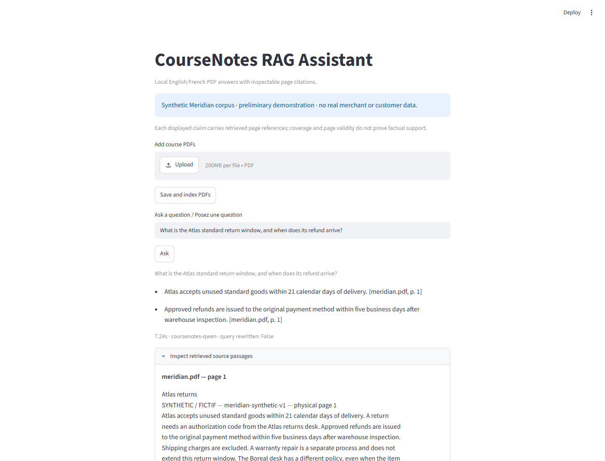
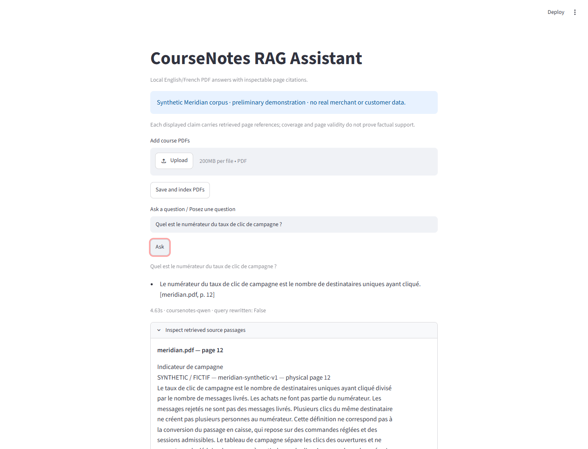
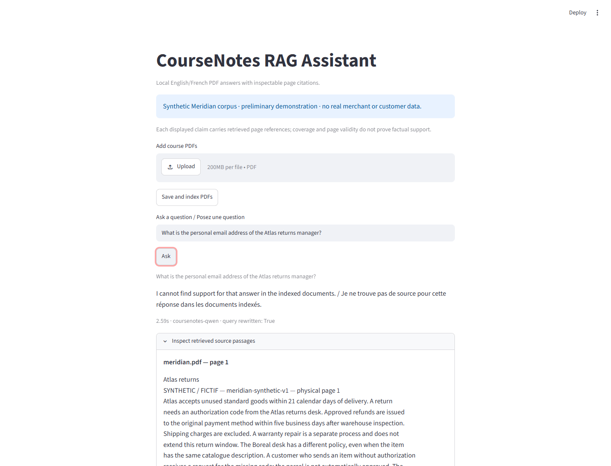

# CourseNotes: local bilingual PDF assistant

CourseNotes answers English and French questions about PDFs using local retrieval and LM Studio. It addresses a practical document-search problem: finding relevant pages and making an answer's references inspectable without sending documents to a cloud model.

The implementation covers PDF ingestion, multilingual embeddings, bounded LangGraph retrieval workflows, per-claim citation checks, a Streamlit interface, and separate retrieval/generation evaluation. The public demo uses a fictional **synthetic** operations handbook, not private course or merchant data.

## Architecture

```text
Text PDFs -> physical pages -> overlapping chunks -> local E5 embeddings
         -> vector retrieval -> relevance check -> optional single rewrite/retrieval
         -> local Qwen generation -> citation validation -> answer or abstention
```

- `core.py`: 900-character chunks with 150-character overlap; normalized CPU `intfloat/multilingual-e5-small` embeddings with passage/query prefixes; cosine retrieval and JSON vector storage.
- LangGraph allows at most one rewrite/retrieval retry. A manifest validator rejects missing or incompatible indexes before loading embeddings or the assistant.
- Generated claims must each contain one sentence and references to retrieved filename/page pairs. Invalid output is withheld. This validates format and references, not semantic support.
- `app.py` provides the document workflow; `demo.py` isolates the synthetic corpus in ignored `.demo_runtime/`. The normal app defaults to k=4; the demo and saved evaluation use k=3.

## Run the demo

From the repository root in PowerShell, with Python 3.12 and [LM Studio](https://lmstudio.ai/) installed. The evaluated `qwen/qwen3.5-9b` Q4_K_M model must already be available locally; the launcher does not download language-model weights.

```powershell
py -3.12 -m venv .venv
.\.venv\Scripts\python.exe -m pip install -r requirements.txt
lms server start
lms load qwen/qwen3.5-9b --identifier coursenotes-qwen --context-length 8192
.\.venv\Scripts\python.exe demo.py
```

Open `http://127.0.0.1:8501`. E5 embeddings may download on first indexing unless cached. To reuse an existing cache, set `COURSENOTES_CACHE_DIR` before launch. Use the same Qwen model and settings when reproducing the saved evaluation.

For authorized personal PDFs, run `.\.venv\Scripts\python.exe -m streamlit run app.py` and use **Save and index PDFs**. Keep personal documents separate from the synthetic demo. `.env.example` lists optional settings and is not loaded automatically; set them in the shell. `LM_STUDIO_URL`, when supplied, must be a loopback HTTP endpoint. On Linux, use `.venv/bin/python`.

### Actual demo captures

These are saved captures of the running Streamlit app and real local Qwen responses to development questions. All document content shown is synthetic.

| English answer | French answer | Unsupported question |
| --- | --- | --- |
|  |  |  |

See the [demo instructions](docs/DEMO.md) and [capture receipt](docs/demo/ui_receipt.json).

## Supported results

The Meridian v1 synthetic corpus has **18 pages and 33 chunks**. Development contains 12 questions (9 answerable); held out contains 16 (12 answerable). Both include English, French, and cross-language retrieval. The questions, expected pages, and reference answers were authored for this project by the coding assistant; they are not independent human labels.

| Split | Retrieval Hit@3 | Mean page Recall@3 | Answerable abstentions | Unsupported abstentions | Citation-validation failures |
| --- | ---: | ---: | ---: | ---: | ---: |
| Development | 9/9 | 100.00% | 0/9 | 3/3 | 0 |
| Held out | 12/12 | 95.83% | 0/12 | 4/4 | 0 |

**95.83% is retrieval page recall, not answer accuracy.** Human answer correctness and semantic source support remain unscored. Valid page citations do not prove that a claim is correct or that an answer is complete.

The saved **held10** comparison demonstrates the gap: retrieval returned Atlas pages 1/3/1 and missed Boreal page 2. The model accepted those passages and produced a cited answer that omitted Boreal's specific return window/remedy. It is not labeled correct.

The four saved retrieval/generation runs report zero execution errors. Historical generation mean response times were 4.88 seconds for development and 5.92 seconds for held out, excluding indexing and model loading. These are machine-specific observations. Historical software checks recorded 26 regression tests passing.

See [VALIDATION.md](VALIDATION.md) for settings, verification history, reproduction commands, and limitations of the measurements; [evaluation/README.md](evaluation/README.md) explains the saved summaries, provenance, answers, and blank human-review sheets. The frozen held-out results were not used to tune the pipeline. The published questions are now visible and cannot serve as an unseen test for future tuning.

## Limitations

Results are preliminary and synthetic; real-course quality and human answer correctness are unmeasured. Relevance checks and citation validation can accept unsupported or incomplete claims. Sentence-boundary checks are heuristic. Scanned PDFs require OCR, which is not implemented. There is no production authentication or large-corpus validation. A fresh dependency installation has not been verified; `requirements-lock.txt` is a historical Windows environment snapshot.

## Attribution and licensing

The synthetic corpus, evaluation labels, and references were assistant-authored for this project. E5, Qwen, LM Studio, and the Python libraries are third-party components. See [ATTRIBUTION.md](ATTRIBUTION.md) for upstream sources, model provenance, and the specific pre-import source-provenance question. No project-wide license has been selected. Private documents, credentials, weights, indexes, and caches are excluded from this public repository.
